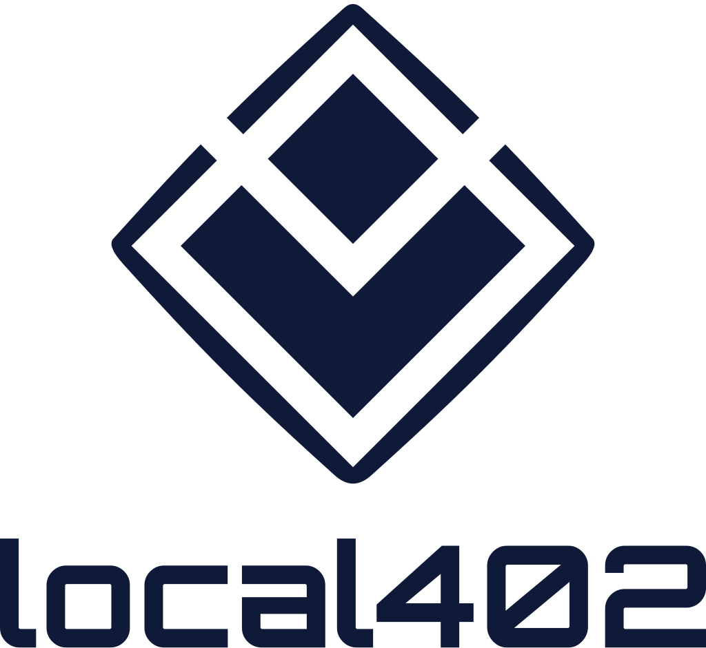

<p align="center"></p>

# Local402

**Pay for any agent service like a local: in your own currency.**

**Local402 connects Celo to the world's data and AI, in both directions.**

| Side | Who | What they do |
|---|---|---|
| Celo → world | Celo agents and the people behind them, holding pesos, reais or naira | sip any paid service, from X and Reddit data to AI answers and Sippar's products, paying in their own currency with no account, card or ID |
| World → Celo | AI assistants such as Claude, through Local402's MCP server | hire services on Celo and pay people and agents there exactly what they ask, in their own currency |

Next: a Celo Unlock card, bought with a bank card, USDC or any stablecoin, spending through Sippar's
connector on dollar services and in local currencies (not built yet).

Agents and the people behind them hold different money. Paid services for AI agents are priced in US
dollars; the people and agents who want them often hold Argentine pesos, Brazilian reais, Colombian
pesos or Nigerian naira — and a freelancer or agent in Buenos Aires or Lagos wants to be paid in theirs.
Local402 connects the two sides on Celo, with [Textile FX](https://docs.textilecredit.com) doing the
exchange at a firm quote every time. **It works both ways:**

- **Local currency in, dollar services out.** Anyone holding wARS, wBRL, wCOP or cNGN sees services priced
  in their currency, pays in it, and the gateway converts on Textile and pays the service over x402.
- **Dollars in, local currency out.** An AI assistant (Claude, or any MCP host) connects Local402's MCP
  server and can hire services on Celo, or pay a person or an agent exactly what they ask in their own
  currency: Textile buys the exact amount, and Local402 sends it.

The services come from two outside shops, both paid per call on Celo:

- [buy](https://usebuy.ai)'s Celo catalogue: x402 services payable in USD₮, including Chainstack RPC,
  Cencori inference, Google Flights, and X, Reddit, TikTok and Instagram data.
- [Sippar](https://sippar.network)'s data and AI products (ids `sippar.*`): social listening, search,
  research, company and chain data, AI answers. Sippar's shop takes Celo's native USDC on its `celo-x402`
  rail (one transfer to the pay-to its 402 names, then `X-PAYMENT: eip155:42220:<tx>`). Local402 keeps a
  small USDC float, refilled from USD₮ in one Textile fill when short, so each call is one tagged transfer
  and no exchange.

Any x402 seller on Celo can be added.

## For judges: try it in 30 seconds

1. Open **https://sippar.network/local402/** and use **Try it**: pick X, Reddit, an AI answer (Cencori),
   Celo RPC (Chainstack) or flights, and ask. The answer comes back paid live on Celo mainnet over x402,
   with its Celoscan link, and the payment then appears in the page's live activity. It pays from a small
   demo wallet that is ours (3 tries per visitor per day).
2. Everything else on that page is read from Celo by your browser: Textile fills, paid calls, the
   attribution tag decoded from each transaction, and the Self Agent ID check.
3. Every transaction is linked below in [Proof on Celo mainnet](#proof-on-celo-mainnet-2026-11-09).

| Track | Where it is met |
|---|---|
| Open Corridors · Textile FX | Fourteen Textile fills in both directions (about 21 USD₮). FX channels turn Textile's ~$1 minimum into one fill that serves many cent-sized calls; failed maker quotes are re-quoted and reservations waited out. |
| Stable Agents: LatAm | Ripio's wARS in and out: peso purchases, a peso FX channel with a refund in pesos, Unlock codes paid in pesos, and an assistant paying a freelancer exactly 1,700 and 1,200 wARS. |
| Open Corridors · USA₮ with x402 | The agent buys USA₮ on Textile with USD₮, then pays a buy seller in USA₮ over x402 (`exact`, EIP-3009), settled by buy's own x402 processor. |
| Build with buy | Sixteen paid x402 calls (in USD₮, and one in USA₮) from the tagged agent wallet into buy's sellers we do not control: X, Reddit, TikTok via Apify, Chainstack, Cencori. |
| On every track | ERC-8004 agent #10063, Self Agent ID #198 on the agent wallet, the attribution tag on every transaction we send. |

Honest gap: every payer so far is ours (the demo buyer and the Try it wallet); the counterparties are
Textile's market makers, buy's sellers and Sippar.

### For people and agents holding local currency (HTTP gateway)

1. `GET /catalog?currency=wARS` lists services with prices in **wARS, wBRL, wCOP or cNGN** from Textile's
   live levels.
2. The buyer pays the gateway in that local stablecoin on Celo.
3. The gateway converts it to USD₮ at a **firm Textile quote** (an on-chain fill against Textile's
   independent market makers) and credits exactly what was filled.
4. `POST /call/:service` pays the service (buy over **x402** in USD₮, Sippar in USDC on Celo) and returns
   the answer.

### For Claude and other AI assistants (MCP server)

```json
{ "mcpServers": { "local402": { "command": "node", "args": ["/path/to/Local402/src/mcp.mjs"],
  "env": { "AGENT_KEY_FILE": "/path/to/agent.key", "ATTRIBUTION_CODE": "celo_…" } } } }
```

| Tool | What it does |
|---|---|
| `celo_services` | find services on Celo, priced in dollars and in a local currency |
| `hire_celo_service` | hire one and return its answer; pay in USD₮, or in pesos/naira converted on Textile first; `sippar.*` products are paid in USDC on Celo |
| `pay_in_local_currency` | pay a person or agent exactly N wARS / wBRL / wCOP / cNGN, funded from dollars via Textile, with a spend cap the user agreed to |
| `celo_rates`, `wallet` | live Textile rates; the agent wallet's balances |

Built for the Celo **Agents on Open Rails** hackathon (Stable Agents: Open Corridors · Textile FX, and
Stable Agents: LatAm).

## Unlock codes: access with no wallet, no account, no ID

Across Latin America many people cannot open the accounts online services ask for: no card that works
abroad, no dollar income, no identity document a sign-up flow accepts. Every x402 service already
skips the account. Local402 skips the rest. Someone who holds pesos pays once (a shop, a friend, a
community group, an NGO), splits the credit into **Unlock codes**, and hands them out over WhatsApp or
on paper. Whoever holds a code buys data and AI with it, from any HTTP client or straight from Claude
through the MCP tool `use_unlock_code`. The code is the credit; nothing else is asked.

Codes are closed-loop prepaid credit: they buy services through Local402 and cannot be cashed out.

| Endpoint / tool | |
|---|---|
| `POST /unlock-codes {count, eachUSDT}` | split a credit into codes (Bearer: the credit token from `/deposit`) |
| `POST /call/:service` with `Authorization: Bearer unlock_…` | spend a code |
| MCP `use_unlock_code {code, serviceId, input}` | the same, from Claude, with no wallet configured |

## FX channels: Textile's minimum as a channel open

A Textile conversion has a floor (about $1) and a fixed cost (spread, fee, gas). Paying for a $0.005
call through its own conversion would be absurd. So Local402 treats one conversion as a **channel open**,
the way an MPP session or an x402 batch-settlement escrow does:

- **Open** — one Textile fill turns the buyer's pesos or naira into a USD₮ balance (≥ $1).
- **Draw** — each call carries an EIP-712 **cumulative voucher** signed by the buyer's wallet
  (`Voucher{channel, cumulative}`). No transaction, no FX. Calling without one returns a 402 that names
  the exact cumulative to sign. The gateway advances from its own record, never the sender's.
- **Close** — a signed `Close{channel, cumulative}`; the unspent balance goes back in the buyer's own
  currency through one more Textile fill (or in USD₮ if it is under Textile's minimum).

The same shape runs the other way for an AI assistant paying people: `open_payee_channel` buys the whole
budget (say 1,800 wARS) in one fill, `channel_pay` signs a voucher per payment that the payee can
verify, and `close_payee_channel` settles everything in one transfer.

Two fills and one settlement for any number of calls: fewer, larger Textile trades, one spread instead
of many. Textile's 60-second firm quotes and a maker that can fail at simulation are handled too: the
client re-quotes, and waits out its own reservation using Textile's `retryAfterMs`.

| Endpoint / tool | |
|---|---|
| `POST /deposit {txHash}` | opens the channel; returns its id (the deposit tx), owner, and the EIP-712 domain |
| `POST /channel/:id/call/:service` | `X-Voucher: base64({cumulative, signature})`; 402 without one |
| `POST /channel/:id/close {cumulative, signature}` | refund the rest in the owner's currency |
| MCP `open_payee_channel` · `channel_pay` · `close_payee_channel` | the same, paying a person or agent |

## How it works

```
buyer (wARS) ──transfer──▶ gateway ──Textile RFQ: wARS→USD₮──▶ gateway (USD₮)
                                                     │
                     answer ◀── x402 (EIP-3009, USD₮) ┴──▶ service (buy gateway: Chainstack, Cencori, …)
                     answer ◀── one tagged USDC transfer ──▶ Sippar product (celo-x402: eip155:42220:<tx>)
```

- **FX:** Textile's v2 RFQ API, keyless. The gateway proves control of its wallet with one EIP-712
  `TakerControl` signature, asks for a firm quote for the exact deposit, approves, re-checks the expiry
  and broadcasts the returned `transactions.swap`.
- **Pricing:** the catalogue converts each USD price with Textile's public `/v2/rfq/levels` ladder. The
  deposit itself converts at the firm quote, so the credit is exactly what Textile filled.
- **Payments out:** a minimal x402 `exact` client signs an EIP-3009 `transferWithAuthorization` in USD₮;
  the seller's facilitator settles it. For Sippar (`src/sippar.mjs`) the gateway reads the Celo
  requirement from Sippar's 402, sends one USDC transfer carrying the attribution tag, and presents the
  tx; if the answer fails, the same tx is presented again rather than paying twice.
- **Gas:** paid in USD₮ through Celo fee abstraction (CIP-64), so the gateway never needs CELO.
- **Attribution:** every transaction the gateway sends carries the ERC-8021 tag issued at hackathon
  enrolment (`@celo/attribution-tags`); the code refuses to send an untagged transaction. x402
  settlements are submitted by the seller's facilitator and cannot carry a tag yet.
- **Identity:** the gateway wallet is registered in the ERC-8004 Identity Registry on Celo
  (`agent.json`, `scripts/register-8004.mjs`) and holds a **Self Agent ID** (#198): a soulbound
  proof-of-human bound to a passport zero-knowledge proof, so anyone can check that a real, unique person
  stands behind the agent. No name, nationality or age was disclosed. Self sits on the agent side only:
  the people Local402 serves never have to show an ID.

## Run it

```bash
npm install
echo 0x<private key> > agent.key && chmod 600 agent.key   # the gateway wallet; fund it with a little USD₮ on Celo
export ATTRIBUTION_CODE=<your ERC-8021 code>
npm run prices      # read-only: live rates and services priced in local currency
npm start           # the gateway on :4020
```

| Endpoint | What it does |
|---|---|
| `GET /` | gateway address, currencies, flow |
| `GET /rates` | local units per USD₮ from Textile levels, with min and max deposit |
| `GET /catalog?currency=wARS&q=flights` | services with their price in the chosen currency |
| `POST /deposit {txHash}` | credits a local-currency transfer to the gateway after converting it on Textile; returns a credit token once |
| `POST /call/:serviceId` | `Authorization: Bearer <credit>`; pays the service over x402 and returns its answer; refunds the credit if the service fails |
| `GET /balance` | remaining credit |
| `GET /history` | deposits, Textile fills and calls |

`node scripts/sippar-quote.mjs reddit-social` reads Sippar's catalogue and one product's Celo price for
free; `node scripts/sippar-demo.mjs` buys two Sippar products on mainnet.

`npm run demo` runs the whole flow on mainnet with a demo buyer wallet (funded by us, so it is not an
independent user).

## Proof on Celo mainnet (2026-11-09)

Gateway / payTo `0xA781caE75185E6aBF8Efbf5E1f5bC7Eb4400D08B` · ERC-8004 agent
[#10063](https://8004scan.io/agents/celo/10063) · demo buyer `0xa9a8fdf5b540489B22B65740310D5f9B66a04328`.
Every transaction both wallets sent carries the ERC-8021 code `celo_b049a252d542` (checked with
`verifyTx` from `@celo/attribution-tags`).

| Step | Transaction |
|---|---|
| Self Agent ID #198, owned by the agent wallet (registry `0xaC3DF9AB…`, `agentKeyToAgentId` → 198, `ownerOf(198)` → agent wallet) | [registry](https://celoscan.io/address/0xaC3DF9ABf80d0F5c020C06B04Cced27763355944) |
| ERC-8004 registration (agent #10063) | [`0x137b55e4…`](https://celoscan.io/tx/0x137b55e4d9d0c41d7485f1f935cf4498ebaca195b25e52a91290adf06e6036e1) |
| **Purchase 1 — Argentine pesos** | |
| Buyer gets 2,488.56 wARS for 1.50 USD₮ (Textile fill) | [`0x3c01212d…`](https://celoscan.io/tx/0x3c01212dc8f6bba0cb4bb977c63c7608f33d59134d16bcd22d9e4a39468481c7) |
| Buyer pays the gateway 2,488.56 wARS | [`0x5bdc89e5…`](https://celoscan.io/tx/0x5bdc89e5e0ea55066d6851e90950fa5dd6165ceec9903622eb0b00cbda520e00) |
| Gateway converts to 1.499092 USD₮ (Textile fill, maker `0x25A5c1Ae…`) | [`0x1e7f262d…`](https://celoscan.io/tx/0x1e7f262d9bf820ea9a32c3187231db97eb7e43f7fa1b8640c11d203aa32da870) |
| x402: X post search, 0.005 USD₮ (buy) | [`0xf0806337…`](https://celoscan.io/tx/0xf0806337a1af5580f24b8452461f166403613246cd5e2e1ff6dedb77b3e9248c) |
| x402: Chainstack Celo RPC, 0.01 USD₮ (buy) | [`0xffc712e8…`](https://celoscan.io/tx/0xffc712e833a27f9d2d1f712abb0508f37f9e529d59f692d4e4209cf415d6fc69) |
| **Purchase 2 — Nigerian naira** | |
| Buyer gets 1,792.39 cNGN for 1.30 USD₮ (Textile fill) | [`0xd5ca4a7f…`](https://celoscan.io/tx/0xd5ca4a7f1b4c7fb9f579745fd7088bd82b07c8553fd33599fcd2383f5a47eaad) |
| Buyer pays the gateway 1,792.39 cNGN | [`0x434fe969…`](https://celoscan.io/tx/0x434fe9691f0777f72b7e20affdbd155349c15203475628135bb80f58f491e45c) |
| Gateway converts to 1.299653 USD₮ (Textile fill, maker `0xF0d95682…`) | [`0x10a38cd6…`](https://celoscan.io/tx/0x10a38cd60077daddebce74ba250207db2af0157569f2921ebb56cd70851ef394) |
| x402: X post search, 0.005 USD₮ | [`0xb735219c…`](https://celoscan.io/tx/0xb735219c3739b47fabf4635f0f911709ea0d6f0572941ab19540f86661a84b2f) |
| x402: Chainstack Celo RPC, 0.01 USD₮ | [`0xe287157d…`](https://celoscan.io/tx/0xe287157d125cc4a8fe7921c42a050894a4bf44fe9371ef7fceabc66c36246990) |
| **Purchase 3 — Argentine pesos, with an AI answer** | |
| Buyer gets 2,074.00 wARS for 1.25 USD₮ (Textile fill) | [`0x19280db7…`](https://celoscan.io/tx/0x19280db7124316cc4b16a4abe4e253220b3f286fa374fc59f6a4927261166128) |
| Buyer pays the gateway 2,074.00 wARS | [`0x29772480…`](https://celoscan.io/tx/0x29772480aa56c3abe845765c5b2903ffded52d1c5b4999e9e6c6fb3ad3ca11ad) |
| Gateway converts to 1.24925 USD₮ (Textile fill) | [`0xab79122f…`](https://celoscan.io/tx/0xab79122f7439ee11459732e97ad3912dcc13efaa63552793d64d05e25149c661) |
| x402: X post search, 0.005 USD₮ | [`0x5d99cc88…`](https://celoscan.io/tx/0x5d99cc88a927aed7c4354180ace726575a75a3365114ec82fd071415f4147aeb) |
| x402: Chainstack Celo RPC, 0.01 USD₮ | [`0xaa32fc58…`](https://celoscan.io/tx/0xaa32fc58f481e745fe368f8138be54d4b1d1403b137aa4a0087a0aeac2fb8a4b) |
| x402: Cencori chat completion, 0.01 USD₮ | [`0x56837cb4…`](https://celoscan.io/tx/0x56837cb499c9987e3c444581ee67cfeba3488f92cba9024cff873e27d95b02f9) |

| **MCP door — an AI assistant hires and pays** | |
| `hire_celo_service`: Reddit search, 0.005 USD₮ over x402 | [`0x4c8ff2ec…`](https://celoscan.io/tx/0x4c8ff2ec03bc418b931284b9ca509f10d1aa2080fedeab9256ae51a14282654e) |
| `pay_in_local_currency`: Textile buys exactly 1,700 wARS for 1.024627 USD₮ | [`0x536796db…`](https://celoscan.io/tx/0x536796db3cb03a83bd7983bdd2cd32c6df68fb08235a762719a6c46a4b71c077) |
| … and sends the 1,700 wARS to the recipient (our demo wallet, standing in for a freelancer) | [`0x8120dcf8…`](https://celoscan.io/tx/0x8120dcf883bc0b7ea018b1198bf5a7540a4015c7a1c997195072ac33349ea806) |

| **FX channel — buyer side (open, 4 voucher draws, close)** | |
| Buyer gets 2,157 wARS for 1.30 USD₮ (now holds 3,855.75 wARS) | [`0xdb8abd9f…`](https://celoscan.io/tx/0xdb8abd9f96481673d6a1b73f032d6e2818d0d72378afd51dfb00ec4d41f067c2) |
| Open: buyer pays the gateway 3,855.75 wARS | [`0xa9cfe350…`](https://celoscan.io/tx/0xa9cfe350cfeb9c755087356d92f448f11bb1576703c794acbc326cf253e0e805) |
| Open: one Textile fill → 2.323768 USD₮ channel balance | [`0x8d228767…`](https://celoscan.io/tx/0x8d228767ead1a5472b4f42ced1c9d9be93742224bfff5079cccd8458ee9e9131) |
| Draws (signed vouchers, cumulative 5000 → 10000 → 20000 → 25000): X, Reddit, Chainstack, X — x402 settlements | [`0xeebde8c0…`](https://celoscan.io/tx/0xeebde8c089ebd82baeb260dbdb9d7dbef7e799fd575fe706f93c07bc9a85fa3f) · [`0x420c4512…`](https://celoscan.io/tx/0x420c4512a414b55d49a6c6478e8416cffe3ca48fc46f9e4317a385e303d0c067) · [`0xa027a4c0…`](https://celoscan.io/tx/0xa027a4c0bb6767cc66b9d7de2ca3b01d6b5c64ff7f3c34a5878b809df93577d0) · [`0xcf9b6aec…`](https://celoscan.io/tx/0xcf9b6aecc45d241d6ab3bdd3db2b83d0867d5fe817a9a7106ac4248a836d9d1e) |
| Close: one Textile fill, 2.298768 USD₮ → 3,811.98 wARS | [`0x9ed9ce87…`](https://celoscan.io/tx/0x9ed9ce87fdbb57bfae55ce327f84d1dc44e31ea60433b3099618f9635b0f9ebb) |
| Close: refund 3,811.98 wARS to the buyer | [`0x7585cbd1…`](https://celoscan.io/tx/0x7585cbd1dc0fdb015c4d5c24aefc50a3146c20d31f0559f746b5532532300ec6) |
| **Payee channel — an AI assistant pays a freelancer (MCP)** | |
| `open_payee_channel`: one Textile fill buys exactly 1,800 wARS for 1.085487 USD₮ | [`0x6178ad6c…`](https://celoscan.io/tx/0x6178ad6c80070c514c4f4b6e8f7f3f60050de5241994aecd59dbde95541d75e5) |
| `channel_pay` ×3 (500, 400, 300 wARS): signed vouchers, no transaction | — |
| `close_payee_channel`: one transfer settles 1,200 wARS (600 unspent kept) | [`0xf030201c…`](https://celoscan.io/tx/0xf030201c593662ec150a87a50300f397d37e11fab584c2ccccdd6b7588d18277) |

| **Unlock codes — pay once in pesos, spend with no wallet** | |
| Buyer pays the gateway 5,011.98 wARS | [`0x3646163c…`](https://celoscan.io/tx/0x3646163c22f33b43a88d62e72ecb5b935a8727a769e6136c2de0431cbaeb8604) |
| One Textile fill → 3.020844 USD₮ credit, split into 5 codes of 0.25 USD₮ | [`0xb55ed554…`](https://celoscan.io/tx/0xb55ed55450e8cb4ba79fcfb75094b5c48e1e9e7dc048414cf590c8f25be6eab7) |
| A code holder with no wallet, through the MCP door: Reddit search (0.005 USD₮) | [`0xdf1f1f44…`](https://celoscan.io/tx/0xdf1f1f44bea65d9fc2858b9889c44b3b7b27d15fef2cad58886b666f6ad1c042) |
| … and a Cencori answer in Spanish (0.01 USD₮) | [`0x60de95eb…`](https://celoscan.io/tx/0x60de95eb9a5a1abc2b17b945321f72b53214e9c9ca79c7a1894809fdbfe39001) |
| **Apify through buy (MCP door)** | |
| `hire_celo_service`: TikTok data from an Apify Actor (ScrapTik), 0.007 USD₮ over x402, provider `apify` | [`0x7cf24168…`](https://celoscan.io/tx/0x7cf24168b6c1a32d0a28802e5485b396d11754b7d3771806f1a30c1839bc696e) |
| **Sippar — products paid in USDC on Celo (`scripts/sippar-demo.mjs`)** | |
| USDC float refilled: one Textile fill, 1.051092 USD₮ → 1.05 USDC | [`0x8b1b9c34…`](https://celoscan.io/tx/0x8b1b9c34179b0475ff4d1790f781929bcd6a74822d49a1abf601034d47e9310c) |
| `sippar.reddit-social`: one tagged 0.02 USDC transfer to Sippar's pay-to, presented as `X-PAYMENT: eip155:42220:<tx>` | [`0x90caffd1…`](https://celoscan.io/tx/0x90caffd1da938f6f457c1a3f40b9335435d69d585a0b7a0b8a61b86eedc686ee) |
| `sippar.news-search`: one tagged 0.01 USDC transfer, answered | [`0x88397bc4…`](https://celoscan.io/tx/0x88397bc4202383e34e37fa9e42b8d186f8df469acb1c980b66135a362409c704) |
| **USA₮ over x402 (`scripts/usat-demo.mjs`)** | |
| Agent buys 1.049318 USA₮ for 1.05 USD₮ (Textile fill, rfq `rfq_JS4-5ZMlT3ywSnxb`) | [`0x42e1e31b…`](https://celoscan.io/tx/0x42e1e31b60f19183e14b37f3e5cb8ae0f0720d6b4405ca4f935773cfed7ab96d) |
| x402: X post search, 0.005 USA₮ (`exact`, EIP-3009 on USA₮ `0xD2ab3C9A…`) to buy's pay-to `0x20faAca5…`; settled by buy's own x402 processor (buy's gateway), not Celo's hosted processor at x402.celo.org | [`0x5397effb…`](https://celoscan.io/tx/0x5397effbe0a185a205bd2fdda2cf84ef5f2a2f815bda6f513c5c6890dfe43ef0) |

Sippar answered the Reddit call 8 seconds after payment, but the client's connection timed out before the
answer arrived. Presenting the same transaction once more returned that answer at no charge, marked
`redelivered`, so a timeout costs neither a second payment nor the answer.

Totals: fourteen Textile fills (about 21 USD₮ quoted and filled, both directions), sixteen paid x402
calls (one of them in USA₮) into services we do not control (X, Reddit, TikTok via Apify, Chainstack, Cencori), and two paid
calls into Sippar's shop over its `celo-x402` rail. Earlier subtotal for the HTTP gateway alone: six Textile fills (about 8.1 USD₮ quoted and filled, both directions, two market makers), seven
paid x402 calls into services we do not control. Textile's 2 bps fee went to its fee recipient on each fill.

## Limits, plainly

- A hackathon prototype. Deposits become prepaid credit held by the gateway wallet until spent.
- The demo buyer wallet is ours and funded by us; it is not an independent user.
- Textile's minimum is about $1 per conversion, so deposits are at least that; calls then draw down the
  credit a few cents at a time.
- wARS and cNGN converted cleanly. USD₮ → wBRL and USD₮ → wCOP firm quotes came back but failed the
  pre-send simulation with `TRANSFER_FROM_FAILED` (nothing was broadcast); at the same time Textile's
  wBRL buy-side depth fell from about 3,700 to about 25 USD₮. The gateway cancels such a quote and frees
  the reservation. wMXN, wPEN and wCLP have no Textile depth on Celo.

## Next

- Accept the local-currency payment directly over x402 through Celo's hosted facilitator (it already
  lists wARS, wBRL and wCOP), instead of transfer-then-deposit.
- More upstreams: any x402 seller, and agents listed in the ERC-8004 registry.
- Hiring people as well as services, paid in their own currency.

## Credits

Built with [Celopedia](https://github.com/celo-org/celopedia-skills) and
[celo-org/agent-skills](https://github.com/celo-org/agent-skills) as the agent's reference, on
[Textile FX](https://textilecredit.com), [buy](https://usebuy.ai), [Sippar](https://sippar.network) and Celo. MIT licence.
